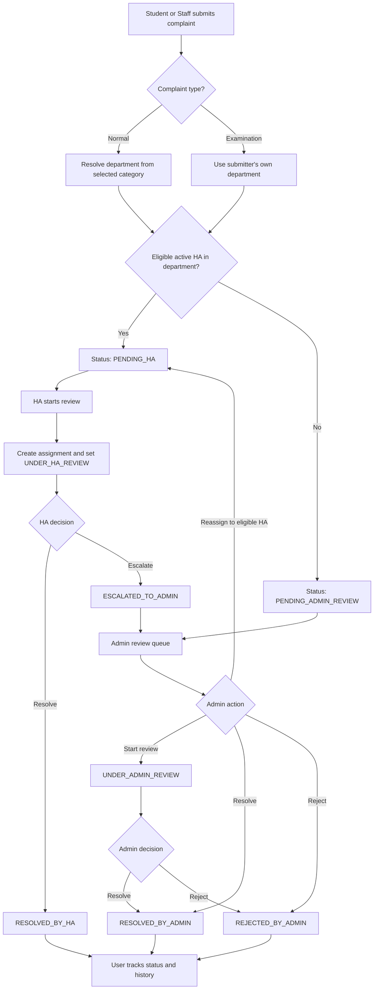

# Complaint Management System (CMS)

A role-based web application for submitting, routing, reviewing, tracking, and resolving complaints within an educational institution.


The application provides separate interfaces for Students, Staff, Higher Authority (HA), and Admin users. Complaints are routed to the department responsible for the selected category, reviewed through a defined HA/Admin workflow, and retained with status history and notifications.

## Contents

- [Overview](#overview)
- [Key capabilities](#key-capabilities)
- [Roles and permissions](#roles-and-permissions)
- [Complaint workflow](#complaint-workflow)
- [Technology stack](#technology-stack)
- [Project structure](#project-structure)
- [Getting started](#getting-started)
- [Environment configuration](#environment-configuration)
- [Initial Admin setup](#initial-admin-setup)
- [API reference](#api-reference)
- [Database overview](#database-overview)
- [Security and file handling](#security-and-file-handling)
- [Verification and testing](#verification-and-testing)
- [Deployment considerations](#deployment-considerations)
- [Project team](#project-team)

## Overview

The Complaint Management System centralizes complaint handling instead of relying on disconnected manual records or informal communication. It combines complaint submission, department-based routing, Higher Authority review, Admin intervention, decision history, notifications, and feedback in one application.

The current implementation uses a browser-based HTML/CSS/JavaScript frontend, a Node.js/Express REST API, and a MySQL database. The frontend is served separately during local development; API calls are sent to the backend at `http://localhost:3000/api` by default.

## Key capabilities

- **Role-based access:** separate Student, Staff, HA, and Admin experiences backed by authenticated API routes.
- **Complaint submission:** Normal and Examination complaint types, priority, subject, description, and optional supporting documents.
- **Department routing:** Normal complaints use the department associated with the selected category. Examination complaints use the submitter's own department.
- **HA-first review:** complaints are routed to an eligible active HA when one is available in the responsible department.
- **Admin fallback:** complaints go to the Admin queue when no eligible active HA is available, and can also be escalated to Admin by HA.
- **Complaint decisions:** HA can resolve or escalate; Admin can review, resolve, reject, or reassign eligible complaints.
- **Complaint history:** status changes and remarks are recorded in the tracker.
- **HA assignment history:** Admin can assign or remove HA responsibilities from existing Staff accounts while retaining HA history.
- **Attachment handling:** optional JPG/JPEG, PNG, and PDF uploads are stored in a private backend directory and downloaded through authenticated endpoints.
- **Notifications:** in-app notifications support unread counts and read-status updates.
- **Feedback:** users can submit a rating and optional comment for an eligible closed complaint.
- **Administration:** department and category management, user listing, dashboard statistics, feedback review, and Staff-to-Admin promotion/demotion.

## Roles and permissions

| Role | Main responsibilities |
|---|---|
| **Student** | Register and sign in, submit complaints, view and track own complaints, download own attachments, reopen an HA-resolved complaint where permitted, and provide feedback when eligible. |
| **Staff** | Register and sign in, submit and track own complaints, and use HA functions when the account has an active HA assignment. |
| **Higher Authority (HA)** | Review complaints routed to the HA's assigned department, start a review, resolve a complaint, or escalate it to Admin. |
| **Admin** | Manage departments and categories, assign/remove HA responsibility, review complaints, reassign complaints to eligible HAs, resolve or reject complaints, review feedback, and view reports. |

### Higher Authority model

HA is an additional responsibility assigned to an existing Staff account. It is not a separate account, login, or ID. The Staff member keeps their existing user ID. The current HA state is represented by the Staff record, while `ha_history` retains department-level assignment history. A Staff member's home department can differ from the department for which they serve as HA.

Admin accounts are not created through the normal public registration flow. The first Admin is created through a one-time setup endpoint protected by `SETUP_KEY`. Additional Admin access is granted by promoting an existing Staff account.

## Complaint workflow



### Complaint status values

| Status | Meaning |
|---|---|
| `PENDING_HA` | Waiting for the responsible department's eligible HA. |
| `UNDER_HA_REVIEW` | An HA has started reviewing the complaint. |
| `PENDING_ADMIN_REVIEW` | Waiting for Admin review, including the no-eligible-HA fallback. |
| `UNDER_ADMIN_REVIEW` | Admin has started reviewing the complaint. |
| `ESCALATED_TO_ADMIN` | HA escalated the complaint to Admin. |
| `RESOLVED_BY_HA` | HA marked the complaint resolved. |
| `RESOLVED_BY_ADMIN` | Admin marked the complaint resolved. |
| `REJECTED_BY_ADMIN` | Admin rejected the complaint with a reason. |

An assignment record is created when an HA starts review, or when Admin assigns/reassigns the complaint. Initial routing to `PENDING_HA` does not itself mean that a Staff assignment record has already been created.

## Technology stack

| Layer | Technologies |
|---|---|
| Frontend | HTML5, CSS3, JavaScript |
| Backend | Node.js, Express 5 |
| Database | MySQL, `mysql2` connection pool |
| Authentication | JSON Web Tokens (JWT), `bcrypt` password hashing |
| File uploads | Multer, filesystem storage, extension/MIME/signature validation |
| API communication | JSON REST endpoints; `multipart/form-data` for complaint attachments |
| Development tools | Visual Studio Code, browser Developer Tools, Postman, Git/GitHub |

## Project structure

```text
CM_System/
├── Backend/
│   ├── config/
│   │   └── db.js
│   ├── controller/
│   │   ├── adminComplaintController.js
│   │   ├── adminController.js
│   │   ├── adminPromotionController.js
│   │   ├── adminReportController.js
│   │   ├── attachmentController.js
│   │   ├── authController.js
│   │   ├── complaintController.js
│   │   ├── feedbackController.js
│   │   ├── haController.js
│   │   ├── notificationController.js
│   │   ├── publicController.js
│   │   ├── setupController.js
│   │   ├── staffController.js
│   │   └── studentController.js
│   ├── middleware/
│   │   ├── authmiddleware.js
│   │   ├── rolemiddleware.js
│   │   └── uploadMiddleware.js
│   ├── routes/
│   │   ├── adminRouter.js
│   │   ├── authRouter.js
│   │   ├── notificationRouter.js
│   │   ├── publicRouter.js
│   │   ├── setupRouter.js
│   │   ├── staffRouter.js
│   │   └── studentRouter.js
│   ├── utils/
│   │   ├── auditHelper.js
│   │   ├── HaRemovalHelper.js
│   │   └── notificationHelper.js
│   ├── package.json
│   └── server.js
├── Database/
│   ├── Schema.sql
│   └── Schema_cms_demo.sql
├── Docs/
│   ├── Department_HA_Workflow.md
│   └── ER Diagram.svg
├── frontend/
│   ├── assets/
│   ├── css/
│   │   ├── Admin/
│   │   ├── Staff/
│   │   ├── Student/
│   │   └── auth/
│   ├── HTML/
│   │   ├── Admin/
│   │   ├── Staff/
│   │   ├── Student/
│   │   └── auth/
│   └── JS/
│       ├── Admin/
│       ├── Staff/
│       ├── Student/
│       └── auth/
├── .env                 # local only; do not commit
├── .gitignore
└── README.md
```

`Backend/private_uploads/` is created by the upload middleware as needed and is intentionally not part of the public frontend. Uploaded documents should remain excluded from version control.

## Getting started

### Prerequisites

Install the following before running the application:

- Node.js (Node.js 20 or later recommended)
- npm, included with Node.js
- MySQL Server and a MySQL client (MySQL Workbench is suitable)
- Visual Studio Code or another editor
- A local static web server extension, such as Live Server, for the frontend

### 1. Clone the repository

```bash
git clone https://github.com/pratikrrajput2006-ship-it/complaint-management-system.git
cd complaint-management-system
```

If you already have the project locally, open the existing `CM_System` directory instead of cloning a second copy.

### 2. Create the database

Create a database in MySQL. For example:

```sql
CREATE DATABASE cms_db
  CHARACTER SET utf8mb4
  COLLATE utf8mb4_unicode_ci;
```

Import **one** schema file into the database you created. For the primary application schema, use `Database/Schema.sql`. You may inspect `Database/Schema_cms_demo.sql` separately if you specifically need the demo variant; do not import both schema files into the same database.

In MySQL Workbench, select the target database and run `Database/Schema.sql`. Confirm the tables are created successfully before starting the API.

### 3. Configure the environment

Create or update `.env` in the **repository root** (alongside `Backend/` and `Database/`). `Backend/config/db.js` loads the file from this location.

Use the following template and replace the example values with your own local configuration:

```dotenv
DB_HOST=127.0.0.1
DB_USER=root
DB_PASSWORD=your_mysql_password
DB_NAME=cms_db
JWT_SECRET=replace_with_a_long_random_secret
SETUP_KEY=replace_with_a_separate_one_time_setup_secret
```

- `DB_HOST`, `DB_USER`, `DB_PASSWORD`, and `DB_NAME` configure the MySQL connection.
- `JWT_SECRET` is required to sign login tokens.
- `SETUP_KEY` protects one-time creation of the first Admin account.

Do not commit `.env`, real credentials, JWT secrets, setup keys, or private complaint documents.

### 4. Install backend dependencies

Open a terminal at the repository root and run:

```powershell
cd Backend
npm install
```

### 5. Start the backend

From the `Backend/` directory, run:

```powershell
node server.js
```

The API listens at:

```text
http://localhost:3000
```

The API base URL is:

```text
http://localhost:3000/api
```

Keep this terminal open while using the application. The database must be running and reachable using the `.env` configuration.

### 6. Start the frontend

Open the repository in Visual Studio Code and start Live Server from:

```text
frontend/HTML/auth/login.html
```

Use the URL opened by Live Server to access the login page. Do not open the HTML page directly as a `file://` URL; a local HTTP server is recommended for frontend API requests.

The shared frontend scripts currently use `http://localhost:3000/api` for local development. Before deployment, configure the frontend API base URL and restrict the backend CORS policy to the actual frontend origin.

## Environment configuration

| Variable | Required | Purpose |
|---|---|---|
| `DB_HOST` | Yes | MySQL server hostname or IP address. |
| `DB_USER` | Yes | MySQL account used by the application. |
| `DB_PASSWORD` | Yes | Password for the MySQL account. |
| `DB_NAME` | Yes | Database containing the CMS schema. |
| `JWT_SECRET` | Yes for login | Secret used to sign JWTs. Use a long, random value. |
| `SETUP_KEY` | Required only for initial setup | One-time setup credential for first Admin creation. |

The example values above are placeholders, not production credentials.

## Initial Admin setup

The first Admin is created through a protected one-time setup endpoint:

```http
POST /api/setup/first-admin
Content-Type: application/json
x-setup-key: <value-of-SETUP_KEY>
```

Example JSON body:

```json
{
  "name": "System Administrator",
  "email": "admin@example.com",
  "phone": "0000000000",
  "employee_no": "EMP001",
  "designation": "Administrator",
  "password": "ReplaceWithAStrongPassword123"
}
```

Use your own details and a strong password; the values above are illustrative only. The endpoint creates the first Admin only while no Admin exists. Subsequent Admin accounts are created by promoting existing Staff accounts through the authenticated Admin API.

After setup, sign in through the login page. Login returns a JWT that the frontend sends in the `Authorization: Bearer <token>` header for protected API requests. Tokens currently expire after one hour.

## API reference

All endpoints below are relative to `http://localhost:3000`. Protected endpoints require a valid bearer token and the appropriate role.

### Authentication, setup, and public data

| Method | Endpoint | Purpose |
|---|---|---|
| `POST` | `/api/login` | Authenticate a user and receive a JWT. |
| `POST` | `/api/setup/first-admin` | One-time Admin setup; requires the `x-setup-key` header. |
| `GET` | `/api/public/departments` | Retrieve public department data. |

### Student

| Method | Endpoint | Purpose |
|---|---|---|
| `POST` | `/api/student/create` | Register a Student account. |
| `GET` | `/api/student/dashboard` | Student dashboard access check. |
| `GET` / `PUT` | `/api/student/profile` | Read or update the Student profile. |
| `GET` | `/api/student/categories/active` | List active complaint categories. |
| `POST` | `/api/student/complaints` | Submit a complaint with an optional attachment. |
| `GET` | `/api/student/complaints` | List complaints submitted by the logged-in Student. |
| `GET` | `/api/student/complaints/:complaint_id` | Get own complaint details and tracker history. |
| `GET` | `/api/student/complaints/:complaint_id/attachment` | Download an authorized private attachment. |
| `PATCH` | `/api/student/complaints/:complaint_id/reopen` | Reopen an HA-resolved complaint when permitted. |
| `POST` / `GET` | `/api/student/complaints/:complaint_id/feedback` | Submit or retrieve complaint feedback. |

### Staff and Higher Authority

| Method | Endpoint | Purpose |
|---|---|---|
| `POST` | `/api/staff/create` | Register a Staff account. |
| `GET` | `/api/staff/dashboard` | Staff dashboard access check. |
| `GET` / `PUT` | `/api/staff/profile` | Read or update the Staff profile. |
| `GET` | `/api/staff/categories/active` | List active complaint categories. |
| `POST` | `/api/staff/complaints` | Submit a complaint with an optional attachment. |
| `GET` | `/api/staff/complaints` | List complaints submitted by the logged-in Staff member. |
| `GET` | `/api/staff/complaints/:complaint_id` | Get own complaint details and tracker history. |
| `GET` | `/api/staff/complaints/:complaint_id/attachment` | Download an authorized attachment for a Staff-accessible complaint. |
| `GET` | `/api/staff/ha/complaints` | List complaints routed to the active HA's department. |
| `GET` | `/api/staff/ha/complaints/:complaint_id` | Get HA complaint details and tracker history. |
| `GET` | `/api/staff/ha/complaints/:complaint_id/attachment` | Download an authorized HA complaint attachment. |
| `PATCH` | `/api/staff/ha/complaints/:complaint_id/start-review` | Start HA review. |
| `PATCH` | `/api/staff/ha/complaints/:complaint_id/resolve` | Resolve a complaint as HA. |
| `PATCH` | `/api/staff/ha/complaints/:complaint_id/escalate` | Escalate a complaint to Admin. |
| `PATCH` | `/api/staff/complaints/:complaint_id/reopen` | Reopen an HA-resolved complaint when permitted. |
| `POST` / `GET` | `/api/staff/complaints/:complaint_id/feedback` | Submit or retrieve feedback for an eligible complaint. |

### Admin

| Method | Endpoint | Purpose |
|---|---|---|
| `GET` | `/api/admin/dashboard` | Admin dashboard access check. |
| `GET` / `PUT` | `/api/admin/profile` | Read or update the Admin profile. |
| `GET` | `/api/admin/staff/:staff_id` | Verify Staff information for HA management. |
| `POST` | `/api/admin/ha/assign` | Assign HA responsibility to an existing Staff member. |
| `POST` | `/api/admin/ha/remove` | Remove an HA assignment while retaining history. |
| `GET` | `/api/admin/staff/:staff_id/ha-history` | View HA assignment history. |
| `POST` / `GET` | `/api/admin/departments` | Create or list departments. |
| `PUT` | `/api/admin/departments/:department_id` | Update department details. |
| `PATCH` | `/api/admin/departments/:department_id/status` | Activate or deactivate a department. |
| `POST` | `/api/admin/categories/create` | Create a complaint category. |
| `GET` | `/api/admin/categories` | List categories. |
| `PUT` | `/api/admin/categories/:category_id` | Update a category. |
| `PATCH` | `/api/admin/categories/:category_id/status` | Activate or deactivate a category. |
| `GET` | `/api/admin/complaints?status=ALL` | List complaints in the Admin queue. |
| `GET` | `/api/admin/complaints?status=HISTORY` | List closed complaint history. |
| `GET` | `/api/admin/complaints/:complaint_id` | Get complaint details and tracker history. |
| `GET` | `/api/admin/complaints/:complaint_id/attachment` | Download an authorized private attachment. |
| `GET` | `/api/admin/complaints/:complaint_id/assignments` | View complaint assignment history. |
| `PATCH` | `/api/admin/complaints/:complaint_id/start-review` | Start Admin review. |
| `PATCH` | `/api/admin/complaints/:complaint_id/resolve` | Resolve a complaint as Admin. |
| `PATCH` | `/api/admin/complaints/:complaint_id/reject` | Reject a complaint with a reason. |
| `PATCH` | `/api/admin/complaints/:complaint_id/reassign` | Reassign an eligible complaint to an HA. |
| `GET` | `/api/admin/feedback` | Retrieve feedback for review. |
| `GET` | `/api/admin/stats` | Retrieve dashboard statistics. |
| `GET` | `/api/admin/users` | List users. |
| `GET` | `/api/admin/ha` | List active HAs; can be filtered by department where supported by the query. |
| `POST` | `/api/admin/users/:user_id/promote` | Promote an existing Staff account to Admin. |
| `POST` | `/api/admin/users/:user_id/demote` | Demote an Admin account to Staff, subject to server-side rules. |

### Notifications

| Method | Endpoint | Purpose |
|---|---|---|
| `GET` | `/api/notifications` | Get notifications for the authenticated user. |
| `GET` | `/api/notifications/unread-count` | Get the user's unread notification count. |
| `PATCH` | `/api/notifications/read-all` | Mark the user's notifications as read. |
| `PATCH` | `/api/notifications/:notification_id/read` | Mark one notification as read. |

Request bodies, valid states, and role restrictions are enforced by the relevant controllers. The API tables summarize the implemented route surface; they do not replace server-side validation.

## Database overview

The primary schema is `Database/Schema.sql`. Its main tables are:

| Table | Purpose |
|---|---|
| `user` | Shared identity, email, password hash, role, status, and contact information. |
| `student` | Student-specific profile and home department. |
| `staff` | Staff profile, home department, designation, and current HA state. |
| `admin` | Admin-specific account information. |
| `department` | Departments and their active/inactive state. |
| `category` | Complaint categories mapped to responsible departments. |
| `ha_history` | Historical records of department-level HA assignments. |
| `complaint` | Complaint details, submitter, type, responsible department, attachment path, status, and resolution. |
| `assignment` | Complaint assignment records, including source and status. |
| `complaint_tracker` | Chronological complaint status changes and remarks. |
| `notification` | In-app notifications for users. |
| `feedback` | One feedback record per complaint, including rating and optional comment. |
| `id_sequence` | Transaction-safe sequences for configured readable entity IDs. |
| `audit_log` | Records selected administrative/system actions. |

The `complaint.department_id` represents the department responsible for a complaint. It is distinct from the department attached to a Student or Staff profile. Assignment and tracker primary keys use database-generated integer IDs in the current schema; they should not be described as readable `ASN###` or `TRK###` IDs.

## Security and file handling

- Passwords are hashed with `bcrypt`; plaintext passwords are not stored.
- Login issues a JWT that expires after one hour. Protected routes verify the token and the relevant role.
- Login rejects inactive user accounts.
- SQL queries use parameterized values for user-provided data.
- The first-Admin setup endpoint requires `SETUP_KEY` and refuses to create another first Admin after setup is complete.
- Attachment uploads accept one optional JPG/JPEG, PNG, or PDF file up to 5 MB. The server checks extension, MIME type, and file signature, and generates a random storage filename.
- Uploaded files are stored under `Backend/private_uploads/`; that directory must not be served through `express.static()` or included in public deployment assets.
- The complaint record stores a relative file reference in the existing `complaint.attachment` column. No binary-file database migration is required.
- Private downloads go through authenticated API routes that check the caller's access before returning a file. Download responses use attachment disposition and `X-Content-Type-Options: nosniff`.
- `Backend/private_uploads/` and `.env` must be excluded from version control. The repository's `.gitignore` should contain these exclusions.

File-type checks reduce accidental or basic spoofed uploads but do not replace malware scanning. Treat uploaded documents as untrusted input.

## Verification and testing

The project currently has no automated test suite configured in `Backend/package.json`; its default `npm test` script is only a placeholder. The following checks are recommended after setup or code changes:

1. Verify the backend can start and connect to MySQL.
2. Test login with valid credentials, invalid credentials, missing tokens, and a token for the wrong role.
3. Submit both Normal and Examination complaints as a Student and as Staff.
4. Confirm an eligible HA receives a complaint in the responsible department, and that the Admin fallback is used when no eligible HA is available.
5. Verify HA review, resolution, escalation, and Admin resolution/rejection/reassignment.
6. Upload a small JPG, PNG, and PDF; confirm the file remains private, its reference is stored, and authorized users can download it.
7. Test unsupported files, zero-byte files, oversized files, and attempts to download attachments without permission.
8. Check that notification and status history records match complaint actions.

Useful syntax checks:

```powershell
cd Backend
node --check server.js
node --check controller\complaintController.js
node --check controller\attachmentController.js
node --check middleware\uploadMiddleware.js
node --check routes\studentRouter.js
node --check routes\staffRouter.js
node --check routes\adminRouter.js
```

Syntax checks are not substitutes for database-backed integration tests.

## Deployment considerations

The repository is configured primarily for local development. Before a production deployment:

- Replace `localhost` frontend API URLs with the deployed API URL.
- Configure CORS to allow only trusted frontend origins.
- Serve both frontend and backend over HTTPS.
- Use strong, unique secrets and least-privilege database credentials.
- Store uploaded files on durable private storage with backups and appropriate access controls.
- Add upload malware scanning, request rate limiting, operational logging, and a documented backup/restore process.
- Verify attachment permissions, account-status checks, complaint transitions, and recovery behavior under deployment conditions.
- Configure the process manager, environment variables, port, and monitoring for the hosting environment.

This README describes the project's current structure and intended workflows. Database-backed integration tests should be run in the target environment before describing any untested behavior as production-verified.
